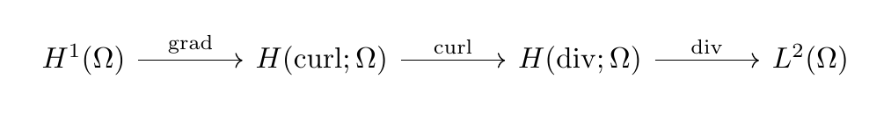
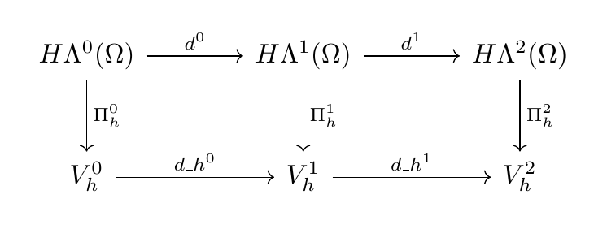
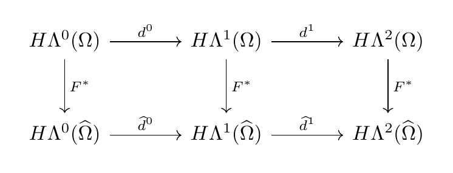
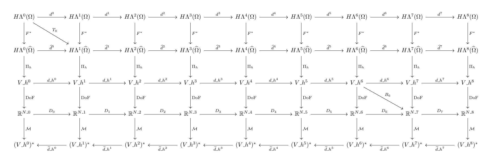

# derham

Have **YOU** ever been sick of being sick of writing the same de Rham diagram in every article? Have you nudged one `tikz-cd` arrow into place, only to discover that the *other* seven arrows have started a small rebellion?

Meet **`derham`**. Tell it which spaces and maps you mean; it lines them up for you. One command gets you a complex. Another gets you a continuous/discrete diagram. Your next paper can contain more mathematics and fewer emergency ampersands.

It uses `tikz-cd` underneath and is aimed at de Rham complexes, commuting diagrams, and finite element exterior calculus (FEEC). A diagram is still not a proof, however handsome the arrows are.

Read the [web guide](https://max-models.github.io/derham/) or download the [executable tutorial notebook](guides/derham_tutorial.ipynb) for compiled examples.

## Quick start

Place `derham.sty` beside your document, or install it in your local TeX tree. The package requires a current LaTeX installation with `amsmath` and `tikz-cd`.

```latex
\documentclass{article}
\usepackage{derham}
\begin{document}
\[\derhamcomplex\]
\[\derhamcommuting\]
\end{document}
```

## Examples

### A 3D vector-calculus complex

```latex
\[\derhamcomplex[dimension=3,notation=vector,spaces=sobolev]\]
```



This uses the familiar grad, curl, and div labels. The [example source](examples/readme-complex.tex) compiles on its own.

### A continuous and discrete commuting diagram

```latex
\[\derhamcommuting[
  dimension=2,
  notation=forms,
  custom-spaces={H\Lambda^0(\Omega),H\Lambda^1(\Omega),H\Lambda^2(\Omega)},
  custom-discrete-spaces={V_h^0,V_h^1,V_h^2},
  maps={\Pi_h^0,\Pi_h^1,\Pi_h^2}
]\]
```



The spaces, horizontal operators, and vertical maps can be customized independently. A drawn square states the intended diagram; it does not prove that the chosen maps commute. See the [example source](examples/readme-commuting.tex).

### Physical and reference domains

```latex
\[\derhammapped[dimension=2,notation=forms,
                spaces=sobolev,pullback=F^*]\]
```



For `F: \widehat\Omega \to \Omega`, the pullback arrows point from physical to reference spaces. The [example source](examples/readme-mapped.tex) compiles on its own.

### Build a diagram from named rows

Use `derhamdiagram` when you need more than two rows or an arrow between different degrees:

```latex
\[
\begin{derhamdiagram}[dimension=2,notation=forms,row-sep=huge]
  \derhamrow[name=physical,kind=continuous]
  \derhamrow[name=reference,kind=reference]
  \derhamconnect[from=physical,to=reference,operator=F^*]
  \derhamconnect[from=physical,to=reference,
                 from-degree=0,to-degree=1,operator=T]
\end{derhamdiagram}
\]
```

The extra `T` arrow is illustrative; define its mathematical meaning for your application. The [manual](output/pdf/derham.pdf) documents the full API, including coefficient-space, dual, broken FEEC, and styling options.

## More examples and development

The [paper-based gallery PDF](output/pdf/paper-gallery.pdf) has diagrams adapted from FEEC sources, with [LaTeX source](examples/paper-gallery.tex). More compilable examples are in [`examples/`](examples/).

Run `l3build check` for regression tests, `l3build doc` to build the manual, or `l3build ctan` to prepare a CTAN submission archive. See the [specification](SPEC.md) and [changelog](CHANGELOG.md). Licensed under LPPL 1.3c or later.

## A slightly bigger diagram

What if you need an eight-dimensional de Rham complex, its reference-domain cousin, a discrete complex, coefficient spaces, *and* dual spaces? Probably take a walk first. Then write:

```latex
\[
\begin{derhamdiagram}[
  dimension=8,notation=forms,spaces=sobolev,
  row-sep=huge,column-sep=huge
]
  \derhamrow[name=physical,kind=continuous]
  \derhamrow[name=reference,kind=reference]
  \derhamrow[name=discrete,kind=discrete]
  \derhamrow[name=coefficients,kind=coefficients,
    operators={D_0,D_1,D_2,D_3,D_4,D_5,D_6,D_7}]
  \derhamrow[name=dual,kind=dual]
  \derhamconnect[from=physical,to=reference,operator=F^*]
  \derhamconnect[from=reference,to=discrete,operator=\Pi_h]
  \derhamconnect[from=discrete,to=coefficients,
    operator=\operatorname{DoF}]
  \derhamconnect[from=coefficients,to=dual,operator=\mathcal M]
  \derhamconnect[from=physical,to=reference,
    from-degree=0,to-degree=1,operator=T_0]
  \derhamconnect[from=discrete,to=coefficients,
    from-degree=6,to-degree=7,operator=B_6]
\end{derhamdiagram}
\]
```

[](output/pdf/readme-mega.pdf)

That's **45 spaces and 78 arrows** from a few row and connection declarations. The extra maps are illustrative; choose real spaces and operators before putting this in a paper. [Open the full-size PDF](output/pdf/readme-mega.pdf) or [compile the source](examples/readme-mega.tex) if your screen has surrendered.
